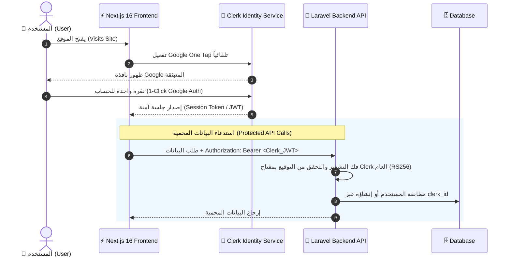

# 🚀 الدليل الشامل لمعمارية Clerk مع Next.js 16 و Laravel API

# 📘 Complete Guide: Clerk Architecture with Next.js 16 & Laravel API

> **وثيقة معمارية وتطبيق عملي (Architectural Blueprint & Implementation Guide)**  
> تم إعداد هذا الدليل ليوضح بدقة نهج Clerk وكيفية دمجه عملياً مع تطبيقات Next.js 16 الحديثة وربطه بنظام حماية خلفي (Laravel API) لدعم تسجيل الدخول بنقرة واحدة (Google One Tap)، وإدارة الجلسات والأدوار بأعلى درجات الأمان والسرعة.

---

## 📑 فهرس المحتويات | Table of Contents

1. [المعمارية العامة والتدفق | Architecture Overview & Data Flow](#1-المعمارية-العامة-والتدفق--architecture-overview)
2. [المرحلة 1: إعداد Clerk في Next.js 16 | Phase 1: Next.js 16 Setup](#2-المرحلة-1-إعداد-clerk-في-nextjs-16--phase-1-nextjs-16-setup)
3. [المرحلة 2: تفعيل تسجيل الدخول بجوجل بنقرة واحدة (Google One Tap) | Phase 2: Google One Tap](#3-المرحلة-2-تفعيل-تسجيل-الدخول-بجوجل-بنقرة-واحدة-google-one-tap)
4. [المرحلة 3: ربط جلسات Clerk مع خادم Laravel API | Phase 3: Integrating Clerk with Laravel API](#4-المرحلة-3-ربط-جلسات-clerk-مع-خادم-laravel-api)
5. [المرحلة 4: إدارة الصلاحيات والأدوار (Admin vs Student) | Phase 4: Role-Based Access Control](#5-المرحلة-4-إدارة-الصلاحيات-والأدوار-admin-vs-student)
6. [المرحلة 5: خطة الترحيل من النظام القديم | Phase 5: Safe Migration Strategy](#6-المرحلة-5-خطة-الترحيل-من-النظام-القديم)

---

## 1. المعمارية العامة والتدفق | Architecture Overview



### المميزات الرئيسية لهذا النهج (Key Benefits):

1. **سرعة التحويل العالية (High Conversion):** تسجيل دخول مباشر في ثوانٍ عبر Google One Tap دون كتابة بيانات.
2. **الأمان العالمي المدار (Managed Security):** إدارة كلمات المرور، استعادة الحسابات، 2FA، ومكافحة البوتات تتم سحابياً بواسطة Clerk.
3. **تكامل متوافق مع خادمك (Seamless Backend Handshake):** Laravel يتحقق من التوكنات محلياً وفورياً دون استدعاء شبكة في كل طلب (باستخدام التشفير اللامتناظر RS256).

---

## 2. المرحلة 1: إعداد Clerk في Next.js 16 | Phase 1: Next.js 16 Setup

### أ) التثبيت والتهيئة عبر الـ CLI (Recommended CLI Init)

يتم تشغيل أداة Clerk الرسمية التي تقوم بالتعرف التلقائي على بيئة العمل وإعداد المتغيرات:

```bash
# تشغيل أداة التهيئة الذكية لـ Clerk
npx -y clerk@latest init
```

_تقوم الأداة تلقائياً بإنشاء مفاتيح التطوير في ملف `.env.local`:_

```env
NEXT_PUBLIC_CLERK_PUBLISHABLE_KEY=pk_test_...
CLERK_SECRET_KEY=sk_test_...
```

---

### ب) ملف الـ Middleware / Proxy في Next.js 16

> [!IMPORTANT]
> في **Next.js 16+** تمت إعادة تسمية ملف الـ Middleware إلى **`src/proxy.ts`** (أو `proxy.ts` في الجذر)، بينما في Next.js 15 وما قبله يُسمى `middleware.ts`.

أنشئ ملف [`src/proxy.ts`](file:///home/suliman/Documents/courses/frontend-course/src/proxy.ts):

```typescript
import { clerkMiddleware, createRouteMatcher } from "@clerk/nextjs/server";

// تعريف المسارات العامة التي لا تتطلب تسجيل دخول
const isPublicRoute = createRouteMatcher([
  "/",
  "/courses(.*)",
  "/api/public(.*)",e
  "/login(.*)",
  "/register(.*)",
]);

export default clerkMiddleware(async (auth, req) => {
  if (!isPublicRoute(req)) {
    // حماية المسارات الخاصة (Student Dashboard / Admin)
    await auth.protect();
  }
});

export const config = {
  matcher: [
    // تخطي الملفات الثابتة والصور وملفات Next الداخلية
    "/((?!_next|[^?]*\\.(?:html?|css|js(?!on)|jpe?g|webp|png|gif|svg|ttf|woff2?|ico|csv|docx?|xlsx?|zip|webmanifest)).*)",
    // تضمين كافة مسارات الـ API
    "/(api|trpc)(.*)",
  ],
};
```

---

### ج) تغليف التطبيق بـ `<ClerkProvider>` في Root Layout

> [!NOTE]
> يجب وضع `<ClerkProvider>` **داخل** وسم `<body>` وليس خارجه لتجنب مشاكل الهيدرة (Hydration mismatches).

في ملف [`src/app/layout.tsx`](file:///home/suliman/Documents/courses/frontend-course/src/app/layout.tsx):

```tsx
import { ClerkProvider } from "@clerk/nextjs";
import { Suspense } from "react";
import "./globals.css";

export default function RootLayout({ children }: { children: React.ReactNode }) {
  return (
    <html lang="ar" dir="rtl">
      <body>
        <ClerkProvider>{children}</ClerkProvider>
      </body>
    </html>
  );
}
```

---

## 3. المرحلة 2: تفعيل تسجيل الدخول بجوجل بنقرة واحدة (Google One Tap)

### أ) إعداد Google OAuth داخل لوحة تحكم Clerk

1. ادخل إلى **Clerk Dashboard** -> **User & Authentication** -> **Social Connections**.
2. فعّل خيار **Google**.
3. (للإنتاج) أضف Google Client ID و Client Secret من Google Cloud Console لضمان ظهور اسم ودومين موقعك الخاص في النافذة المنبثقة.

### ب) إضافة مكون `<GoogleOneTap />`

يوضع المكون مباشرة داخل الـ Layout الرئيسي أو داخل صفحات تسجيل الدخول:

```tsx
// src/components/auth/GlobalAuthControls.tsx
"use client";

import { GoogleOneTap, Show, SignInButton, SignUpButton, UserButton } from "@clerk/nextjs";
import { Suspense } from "react";

export function HeaderAuthControls() {
  return (
    <div className="flex items-center gap-3">
      {/* نافذة Google One Tap التلقائية للزوار غير المسجلين */}
      <GoogleOneTap />

      <Suspense fallback={<div className="w-8 h-8 rounded-full bg-slate-200 animate-pulse" />}>
        {/* حالة الزائر (غير مسجل) */}
        <Show when="signed-out">
          <SignInButton mode="modal">
            <button className="px-4 py-2 text-sm font-medium text-slate-700 hover:text-primary">
              تسجيل الدخول
            </button>
          </SignInButton>
          <SignUpButton mode="modal">
            <button className="px-4 py-2 text-sm font-medium text-white bg-primary rounded-lg shadow-sm">
              إنشاء حساب
            </button>
          </SignUpButton>
        </Show>

        {/* حالة المستخدم المسجل */}
        <Show when="signed-in">
          <UserButton
            afterSignOutUrl="/"
            userProfileMode="modal"
            appearance={{
              elements: {
                avatarBox: "w-9 h-9 border border-border",
              },
            }}
          />
        </Show>
      </Suspense>
    </div>
  );
}
```

---

## 4. المرحلة 3: ربط جلسات Clerk مع خادم Laravel API

هذه هي الخطوة الأكثر أهمية: **كيف نجعل Laravel يثق بالطلبات القادمة من Next.js المحمية بـ Clerk؟**

### أ) آلية إرسال التوكن من Next.js (Token Forwarding)

في Next.js Server Components أو داخل البروكسي الداخلي [`src/app/api/[...path]/route.ts`](file:///home/suliman/Documents/courses/frontend-course/src/app/api/[...path]/route.ts)، نقوم بقراءة التوكن من Clerk وتمريره في ترويسة الطلب:

```typescript
import { auth } from "@clerk/nextjs/server";
import { NextRequest, NextResponse } from "next/server";

export async function forwardToLaravel(req: NextRequest, endpoint: string) {
  // 1. استخراج التوكن الخاص بالمستخدم المسجل
  const { getToken, userId } = await auth();
  const token = await getToken();

  const headers: HeadersInit = {
    Accept: "application/json",
    "Content-Type": "application/json",
  };

  // 2. حقن التوكن كـ Bearer Header إذا كان المستخدم مسجلاً
  if (token) {
    headers["Authorization"] = `Bearer ${token}`;
  }

  // 3. إرسال الطلب إلى Laravel API
  const backendResponse = await fetch(`${process.env.LARAVEL_API_URL}${endpoint}`, {
    method: req.method,
    headers,
    body: ["GET", "HEAD"].includes(req.method) ? undefined : await req.text(),
  });

  return new NextResponse(await backendResponse.text(), {
    status: backendResponse.status,
    headers: { "Content-Type": "application/json" },
  });
}
```

---

### ب) التحقق من التوكن في خادم Laravel (Laravel JWT Verification)

في خادم Laravel، لا نحتاج لاستدعاء سيرفر Clerk في كل طلب (Network Call)، بل نتحقق رياضياً من التوقيع الرقمي (RS256) باستخدام **مفتاح Clerk العام (PEM Key)**.

#### 1. استخراج المفتاح العام من Clerk

- في لوحة تحكم Clerk: اذهب إلى **API Keys** -> **JWT verification key**.
- انسخ المفتاح العام بصيغة PEM وضعه داخل: `storage/app/clerk-public.pem`.

#### 2. تثبيت مكتبة JWT في Laravel

```bash
composer require firebase/php-jwt
```

#### 3. إنشاء Middleware في Laravel (`VerifyClerkJwt.php`)

```php
<?php

namespace App\Http\Middleware;

use Closure;
use Exception;
use Firebase\JWT\JWT;
use Firebase\JWT\Key;
use Illuminate\Http\Request;
use Symfony\Component\HttpFoundation\Response;
use App\Models\User;

class VerifyClerkJwt
{
    public function handle(Request $request, Closure $next): Response
    {
        // 1. استخراج التوكن من الـ Authorization Header
        $token = $request->bearerToken();

        if (!$token) {
            return response()->json(['message' => 'Unauthenticated (No Token)'], 401);
        }

        try {
            // 2. قراءة المفتاح العام
            $publicKey = file_get_contents(storage_path('app/clerk-public.pem'));

            // 3. فك تشفير التوكن والتحقق من صلاحيته
            $decoded = JWT::decode($token, new Key($publicKey, 'RS256'));

            // $decoded->sub يحتوي على معرف المستخدم الفريد في Clerk (e.g. user_2P3...)
            $clerkId = $decoded->sub;

            // 4. مزامنة المستخدم محلياً في جدول users بـ Laravel
            $user = User::firstOrCreate(
                ['clerk_id' => $clerkId],
                [
                    'name' => $decoded->name ?? 'Student',
                    'email' => $decoded->email ?? '',
                    'role' => $decoded->role ?? 'student',
                    'password' => bcrypt(str()->random(24)), // كلمة مرور عشوائية غير مستخدمة
                ]
            );

            // 5. تسجيل المستخدم في سياق الطلب الحالي (Auth Context)
            auth()->setUser($user);
            $request->merge(['user' => $user]);

        } catch (Exception $e) {
            return response()->json([
                'message' => 'Invalid or Expired Clerk Token',
                'error' => $e->getMessage()
            ], 401);
        }

        return $next($request);
    }
}
```

---

## 5. المرحلة 4: إدارة الصلاحيات والأدوار (Admin vs Student)

يوفر Clerk ميزة **`publicMetadata`** لتخزين بيانات مخصصة عن المستخدم، مثل نوع الحساب (`student` أو `admin`).

### أ) ضبط الدور في Clerk

عند إنشاء المستخدم أو ترقيته من لوحة التحكم أو الـ API:

```json
{
  "publicMetadata": {
    "role": "admin"
  }
}
```

### ب) تضمين الدور داخل الـ JWT تلقائياً

في Clerk Dashboard:

1. اذهب إلى **JWT Templates**.
2. أنشئ قالباً أو عدل الـ Default Session Token بإضافة المطالبة (Claim):

```json
{
  "role": "{{user.public_metadata.role}}"
}
```

### ج) فحص الدور في كود Next.js (RSC Guard)

في صفحات الإدارة مثل [`src/app/(admin)/layout.tsx`](<file:///home/suliman/Documents/courses/frontend-course/src/app/(admin)/layout.tsx>):

```tsx
import { auth, currentUser } from "@clerk/nextjs/server";
import { redirect } from "next/navigation";

export default async function AdminLayout({ children }: { children: React.ReactNode }) {
  const { sessionClaims } = await auth();

  // قراءة الدور مباشرة من الـ Claims المشفرة في التوكن
  const role = (sessionClaims as any)?.role;

  if (role !== "admin") {
    redirect("/dashboard");
  }

  return <>{children}</>;
}
```

---

## 6. المرحلة 5: خطة الترحيل من النظام القديم (Migration Strategy)

عند الرغبة بالانتقال التدريجي بدون تعطيل الخدمة:

1. **الخطوة 1: تجهيز Laravel لدعم النظامين مؤقتاً (Hybrid Auth Guard):**
   - اجعل الـ API يقبل التوكن القديم (Sanctum) أو توكن Clerk عبر التحقق المزدوج.
2. **الخطوة 2: إضافة عمود `clerk_id` في جدول `users` بـ Laravel:**
   ```bash
   php artisan make:migration add_clerk_id_to_users_table
   ```
3. **الخطوة 3: تفعيل الربط التلقائي بواسطة البريد الإلكتروني (Email Auto-Link):**
   - عندما يسجل طالب قديم دخوله عبر Clerk بنفس بريده الإلكتروني المسجل به سابقاً في المنصة، يقوم خادم Laravel بربط الـ `clerk_id` الجديد بسجل الطالب القديم فوراً، فيحتفظ الطالب بكافة كورساته وتقدمه وسجلاته السابقة دون أي فقدان للبيانات.

---

## 🏁 الخلاصة وتوصية التطبيق | Final Recommendation

| الميزة             | ما تحصل عليه بعد التطبيق                                   |
| :----------------- | :--------------------------------------------------------- |
| **Google One Tap** | بطاقة دخول فورية بنقرة واحدة بمجرد زيارة الموقع            |
| **تجربة المستخدم** | واجهات دخول وملف شخصي عالمية المستوى وبدون كود واجهات مخصص |
| **صيانة الأمان**    | حماية كاملة من استعادة الحسابات وتأمين كلمات المرور و2FA   |
| **سرعة التطوير**   | توفير مئات ساعات العمل على صيانة أنظمة الدخول والـ OAuth   |

_هذا الملف يمثل المرجع المعماري الكامل لك عند البدء بالتطبيق العملي خطوة بخطوة._
