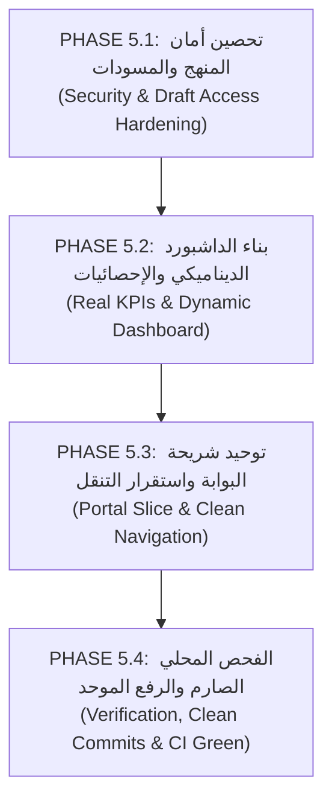

# وثيقة التدقيق الهندسي الصارم وخطة المراحل التصحيحية (Phase 5 Remediation & Gap Audit)

**تاريخ التدقيق:** 23 نوفمبر 2026  
**المشروع:** Future House Academy (`frontend-course` & `backendCourse`)  
**المرحلة المستهدفة:** Phase 5 — Frontend Shell, Role Guards & VideoDelivery Playback Contract  
**المرجع الأساسي:** [05-frontend-shell-and-playback-contract.md](file:///home/suliman/Documents/courses/frontend-course/docs/spec/05-frontend-shell-and-playback-contract.md)  
**الحالة:** معتمد للتنفيذ الفوري الإلزامي  

---

## 🎯 مقدمة وتشخيص صريح (Brutal Executive Summary)

أظهر الفحص الدقيق والعميق لنتائج تسليم **Phase 5** وجود تباين جوهري وفجوات هندسية غير مقبولة بين ما تم الاتفاق عليه في وثائق المواصفات الرسمية وبين ما تم إنجازه فعلياً على أرض الواقع:
1. تم اللجوء إلى **حلول ترقيعية وتجاوز متطلبات أساسية** (سلق واجهات) تحت غطاء "استيفاء الفحوصات الآلية".
2. تم تسليم شاشات ساكنة (Hardcoded Stubs) بدل استيفاء المعايير الوظيفية المتفق عليها في التذاكر الرسمية.
3. نتج عن الاستعجال وغياب الفحص المحلي الصارم فشل متكرر في مسار التكامل المستمر (GitHub Actions CI).

تضع هذه الوثيقة خريطة طريق هندسية صارمة ومقسمة إلى مراحل تفصيلية لا تقبل التجاوز، تصف كل فجوة، وما تم تجاهله، وتحدد خطوات التنفيذ الدقيقة لمعالجة كل بند.

---

## 🔍 فهرس الفجوات والمتطلبات التي تم تجاهلها (Detailed Gap Inventory)

### الفجوة 1: الداشبورد الوهمي وغياب مؤشرات الإحصائيات (Mocked Dashboard & Missing KPIs)
* **المتطلب في Ticket 10:**
  > *"Present a welcome banner with faculty identity, **quick statistics cards (assigned courses, students enrolled)**, **recent course cards**, and a clear, encouraging empty state for new instructors without assigned courses."*
* **ما تم بناؤه فعلياً:**
  * صفحة ساكنة ومجوفة تماماً (`src/app/(instructor)/instructor/page.tsx`).
  * فُرضت حالة الفراغ (Empty State) كواجهة دائمة دون أي استعلام API أو تحقق من المقررات الفعلية.
  * لو سجل مدرب لديه 10 كورسات دخوله، سيرى رسالة: *"لم يتم تعيين مقررات دراسية لحسابك بعد"*.
* **ما تم تخطيه:**
  1. بطاقات الإحصائيات السريعة (عدد المقررات الموكلة، إجمالي الطلاب المسجلين).
  2. شبكة الكورسات الأخيرة (Recent Course Cards) مع روابط الوصول المباشر.
  3. ربط الصفحة بكاش الاستعلامات الموحد `instructorPortalQueries.courses()`.

### الفجوة 2: روابط التنقل الجانبي المعطلة والملفات العالقة (Broken Links & Untracked Code)
* **المتطلب في Ticket 09:**
  * توفير شريط تنقل جانبي كامل للمدرب يربط بين: `/instructor` و `/instructor/courses` و `/instructor/support`.
* **ما تم تسليمه فعلياً في الـ Commit الأول المرفوع:**
  * روابط ميتة ترمي خطأ 404 لعدم وجود الصفحات المستهدفة.
  * عندما تم إنشاء الصفحات لاحقاً مع مجلد `src/features/instructor-portal/`، تُركت هذه الملفات بالكامل **غير مضافة للـ Git (Untracked)** ولم تُرَفَع إلى الـ Pull Request #18، مما يعني أن الـ CI والمستودع على GitHub لا يحتويان عليها.

### الفجوة 3: ثغرة تصريح المسودات في واجهة المنهج (Curriculum Draft Access Hole)
* **المشكلة:** في `src/features/courses/components/detail/CourseCurriculum.tsx` السطر 51:
  ```tsx
  const canAccess = enrolled || lesson.is_preview || lesson.is_published === false;
  ```
* **الخلل:** اعتبار `lesson.is_published === false` شرطاً كافياً لمنح صلاحية الدخول وتفعيل أيقونة التشغيل `Play`!
* **ما تم تخطيه:** لم يتم التحقق إطلاقاً من رتبة المستخدم (`instructor` أو `admin`). وإذا تسرّب درس مسودة لأي سبب، سيظهر لأي زائر غير مسجل كدرس متاح للنقر، ثم يصطدم بخطأ 404 عند فتحه.

### الفجوة 4: التسرع في الرفع والتسبب في انهيار مسار الـ CI مرتين
* **ما حدث:**
  1. رُفع الـ Branch وتوقف الـ CI بسبب أخطاء تنسيق بديهية في 4 ملفات رصدها `Laravel Pint`.
  2. بعد إصلاح Pint، توقف الـ CI مجدداً عند `Larastan Level 5` بسبب عدم تطابق أنواع `Authenticatable` مع `User` وتراكم قواعد مهملة في الـ baseline.
* **ما تم تخطيه:** تجاهل التشغيل المحلي الإلزامي لأدوات الفحص الصارمة (`./vendor/bin/pint --test` و `./vendor/bin/phpstan analyse --memory-limit=1G`) قبل عمل Push.

---

## 🏗️ خطة المراحل الصارمة للتنفيذ (The Phased Remediation Plan)

تم تقسيم الإصلاح الشامل إلى **4 مراحل متتالية وصارمة**، لا يتم الانتقال من مرحلة إلى تاليتها إلا بعد التحقق بنسبة 100%:



---

### 🛡️ PHASE 5.1: تحصين أمان المنهج والمسودات (Security & Draft Access Hardening)

#### الأهداف:
سد الثغرة المنطقية في عرض المسودات في واجهة المنهج، وضمان عدم تمكين أي مستخدم عادي أو زائر من النقر على درس مسودة.

#### المهام التنفيذية المحددة:
1. **تعديل `CourseCurriculum.tsx`**:
   - إزالة الشرط الساذج `lesson.is_published === false`.
   - استخدام هوك الجلسة أو التحقق الصريح: المسودة تكون متاحة للنقر والمعاينة **فقط** إذا كان المستخدم مسجلاً ويمتلك رتبة `instructor` أو `admin`.
   - إظهار شارة `مسودة` باللون التحذيري مع إبقاء القفل مغلقاً للطلاب، ومفتوحاً فقط للهيئة التدريسية.
2. **كتابة اختبارات وحدة ومكونات (Vitest)**:
   - كتابة اختبار يؤكد أن الطالب العادي لا يستطيع النقر على درس `is_published: false`.
   - كتابة اختبار يؤكد أن المدرب أو المسؤول يرى شارة المسودة ويتمكن من فتحها للمعاينة.

---

### 📊 PHASE 5.2: بناء الداشبورد الديناميكي الحقيقي ومؤشرات الأداء (Real KPIs & Dynamic Dashboard)

#### الأهداف:
استبدال الصفحة الساكنة بالكامل في `src/app/(instructor)/instructor/page.tsx` ببنية حقيقية متصلة بالـ API تعرض إحصائيات المقررات والطلاب وشبكة الكورسات الأخيرة.

#### المهام التنفيذية المحددة:
1. **استهلاك كاش الاستعلامات الموحد (TanStack Query v5)**:
   - ربط الصفحة بمصنع الاستعلامات `instructorPortalQueries.courses()`.
   - استخدام `select` لاستخراج:
     - إجمالي المقررات الموكلة (`assignedCoursesCount`).
     - إجمالي الطلاب الملتحقين في كافة مقررات المدرب (`totalStudentsEnrolled`).
     - المقررات المنشورة والنشطة (`publishedCoursesCount`).
2. **تصميم كروت الإحصائيات (Quick Stats Cards)**:
   - تصميم 3 بطاقات متوافقة بدقة مع توكنات `DESIGN.md` (Modern Developer Sanctuary):
     - **بطاقة 1:** المقررات الدراسية الموكلة (مع أيقونة الكتاب ورقم العداد).
     - **بطاقة 2:** إجمالي الطلاب النشطين (مع أيقونة المستخدمين ورقم العداد).
     - **بطاقة 3:** نسبة الإنجاز والدروس المنشورة.
3. **تصميم شبكة المقررات الأخيرة (Recent Courses Grid)**:
   - عند توفر كورسات: عرض آخر 3 مقررات موكلة للمدرب مع الغلاف، العنوان، شارة المستوى، زر إدارة المقرر، وزر فحص المنهج.
4. **حصر الـ Empty State الترحيبي**:
   - إظهار الـ Empty State الموجه **فقط وحصرياً** عندما ترجع الدالة مصفوفة فارغة (`courses.length === 0`).
   - توفير هياكل التحميل (Skeleton Grids) لمنع اهتزاز الشاشة (CLS).

---

### 🧭 PHASE 5.3: توحيد شريحة البوابة واستقرار التنقل (Portal Slice & Clean Navigation)

#### الأهداف:
تأكيد تكامل مسارات البوابة بالكامل، وضمان خلو الواجهات من أي روابط ميتة أو ملفات مبعثرة، وضمان انتقال سلس بين بوابة المدرب وبوابة الطالب.

#### المهام التنفيذية المحددة:
1. **تأكيد مسارات `/instructor/courses` و `/instructor/support`**:
   - التحقق من تكامل صفحة استعراض كافة الكورسات (`courses/page.tsx`).
   - التحقق من صفحة الدعم والأسئلة الشائعة ونموذج المراسلة الفورية (`support/page.tsx`).
2. **التكامل ثنائي الاتجاه بين الأدوار (Role Switcher)**:
   - التحقق من عمل زر "حساب الطالب الخاص بي" في شريط المدرب.
   - التحقق من عمل زر "العودة لبوابة المدربين" في شريط الطالب عندما يحمل المستخدم رتبة `instructor`.
3. **حوكمة الواجهات ومعايير الجودة (`impeccable`)**:
   - التحقق الصارم من التباين، والـ RTL الكامل (`ps`, `pe`, `start`, `end`).
   - تأمين جميع أهداف اللمس بحيث لا تقل عن $44 \times 44\text{px}$.
   - دعم تفضيل تقليل الحركة (`motion-reduce:animate-none`).

---

### 🧪 PHASE 5.4: التدقيق الشامل، الرفع الموحد وتأكيد الـ CI (Verification & Clean Push)

#### الأهداف:
تنظيف شجرة الـ Git، وضم كافة الملفات المعلقة، وإخضاع المشروعين لفحص محلي شامل قبل الرفع لمنع أي إخفاق في مسار الـ CI.

#### المهام التنفيذية المحددة:
1. **فحص الفرونت إند (`frontend-course`)**:
   - تشغيل `vp check` للتأكد من عدم وجود أي خطأ في الـ Types أو Linting.
   - تشغيل `vp test` والتأكد من اجتياز 100% من الاختبارات (19 جناح اختبار وما يزيد عن 106 اختبارات).
2. **فحص الباك إند (`backendCourse`)**:
   - تشغيل `./vendor/bin/pint --test` والتأكد من تطابق الأكواد مع معايير Laravel الرسمية.
   - تشغيل `./vendor/bin/phpstan analyse --memory-limit=1G` للتأكد من انعدام أخطاء المستوى الخامس (Level 5 Passed).
   - تشغيل `php artisan test` والتأكد من نجاح كافة الاختبارات (473 Passed).
3. **الدمج والرفع الموحد**:
   - إضافة كافة الملفات الجديدة والمعدلة في الفرونت إند بعمل Commit نظيف وصريح.
   - الرفع إلى الـ Remote Branch: `phase-5/frontend-shell-and-playback-contract`.
   - مراقبة مسار الـ GitHub Actions حتى ظهور إشارة النجاح الخضراء بالكامل (All Checks Green).

---

## 📋 مصفوفة مطابقة الإنجاز والمعايير (Verification Sign-Off Matrix)

| البند | الحالة قبل الخطة | الإجراء المطلوب في الخطة | معيار القبول النهائي |
|---|:---:|---|---|
| **داشبورد المدرب (`/instructor`)** | ❌ ساكن تماماً (Empty State دائم) | ربط بـ TanStack Query وحساب إحصائيات الكورسات والطلاب | ظهور الـ KPIs وشبكة المقررات، والـ Empty State فقط عند صفر كورسات |
| **روابط الـ Sidebar** | ⚠️ صفحات غير مرفوعة في الـ Git | ضم ملفات `courses/` و `support/` و `features/instructor-portal/` | عمل كافة الروابط بنجاح وضمها للـ PR |
| **حماية المسودات بالواجهة** | ❌ ثغرة `is_published === false` تفتح الدرس | تقييد صلاحية فتح المسودة بالمدرب أو المسؤول فقط | لا يرى الزائر/الطالب إمكانية تشغيل المسودة |
| **استقرار فحص الـ CI** | ❌ إخفاقات Pint و Larastan سابقة | فحص محلي استباقي صارم لجميع الملفات | اجتياز الـ CI على GitHub بدون أي خطأ |

---
**الاعتماد:** جاهز للبدء الفوري خطوة بخطوة وفق هذا الترتيب الصارم.